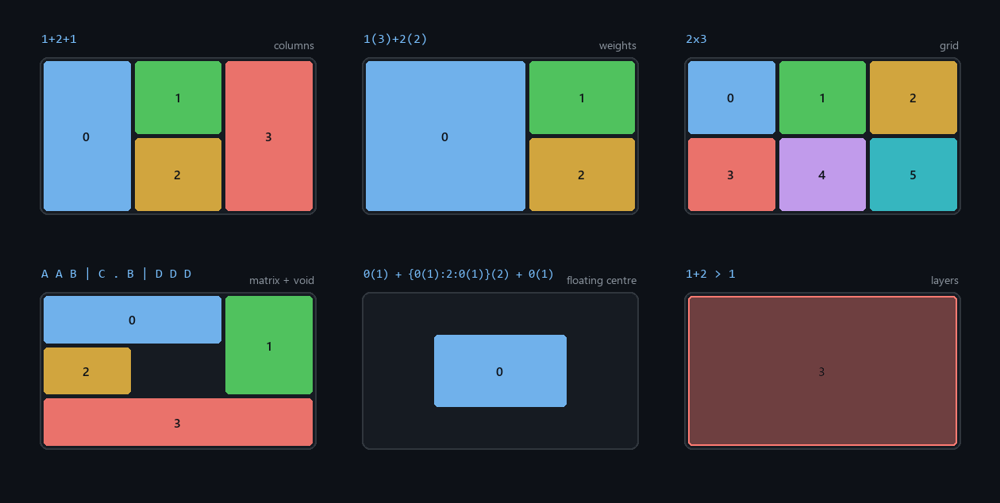

# FancyZones DSL Tiler

**English** · [Русский](README.ru.md)

[](LICENSE)
[](https://www.python.org/)
[](https://flowlauncher.com)
[](https://github.com/RADiant-Git/FancyZones-DSL/actions/workflows/publish-release.yml)

A [Flow Launcher](https://flowlauncher.com) plugin that turns short text formulas into
[PowerToys FancyZones](https://github.com/microsoft/PowerToys) layouts:

```text
fz 1(3)+2(2) -s 8 Code
```

Type the formula → press `Enter` → the layout is compiled, saved into PowerToys and applied to the
target monitor. No settings window, no mouse.



*Every panel above is rendered straight from `FZCompiler` output, so the picture cannot drift away
from what the plugin actually builds.*

## Highlights

- ⌨️ **Keyboard-first** — the whole layout lives in one line of text.
- ⚖️ **Weights and proportions** — `1(3)+2(2)` instead of dragging dividers.
- 🕳️ **Voids** — reserve desktop space for widgets or a floating window.
- 🥞 **Layers** — `>` stacks layouts into one canvas with explicit Z-order.
- 🖥️ **Multi-monitor** — `-m 2`, `-m msi` or `-m all`, gaps matched to the real resolution.
- 🔥 **Hotkeys** — `-k 3` binds `Win + Ctrl + Alt + 3`.

---

## Installation

Requires Flow Launcher and PowerToys with the FancyZones module enabled. The plugin talks to
PowerToys through the official `FancyZonesCLI.exe`, which ships with PowerToys.

**From the plugin store**

```text
pm install FancyZones DSL Tiler
```

**Manually** — download `FancyZonesDSL.zip` from the
[latest release](https://github.com/RADiant-Git/FancyZones-DSL/releases/latest) and unpack it into
`%APPDATA%\FlowLauncher\Plugins\FancyZonesDSL\`.

**From source**

```cmd
git clone https://github.com/RADiant-Git/FancyZones-DSL.git "%APPDATA%\FlowLauncher\Plugins\FancyZonesDSL"
```

The `lib/` folder with the dependency is committed, so `pip install` is not needed. Restart Flow
Launcher afterwards (`Ctrl + R` in its search bar).

The action keyword is `fz`; you can change it in the plugin settings.

---

## Syntax

```text
fz <geometry | layers> [-s <px>] [-k <0-9>] [-m <monitor>] [Name]
```

| Flag | Meaning | Default |
| :--- | :--- | :--- |
| `-s <px>` | gap between zones, `0…200` | `16` |
| `-k <0-9>` | bind the hotkey `Win + Ctrl + Alt + N` | — |
| `-m <monitor>` | number (1-based), name/serial substring, or `all` | active monitor |

Flags also work with the names of saved layouts:

```text
fz Code -m 2         apply the saved "Code" to monitor #2
fz Master L -k 5     bind Win+Ctrl+Alt+5
fz -m all            list every layout, each applicable to all monitors
```

Without a name the layout goes into the reusable `Temp` slot — one per monitor, so overwriting a
formula on one screen never changes the grid on another. Give the layout a name to keep it permanently.

### Blocks

Every element of a column (`+`) or row (`/`) chain is described by two numbers: how many zones it
holds and how much space it takes relative to its siblings.

| Form | Zones | Weight | Meaning |
| :--- | :---: | :---: | :--- |
| `1` | 1 | 1 | one zone of base size |
| `1(2)` | 1 | 2 | one zone twice the base size |
| `N` | N | 1 | `N` equal zones |
| `N(w)` | N | w | `N` equal zones in a block `w` times the base size |
| `0` / `0(w)` | 0 | 1 / w | void (free desktop) |
| `{3:1}` | 2 | 1 | a block split 75 % / 25 % |
| `{1:0:1}` | 2 | 1 | zone, void, zone |

Inside `{}` the numbers are **weights**, not counts: `{3:1}` yields two zones, not three. Outside
braces a bare number is a count: `3` means three equal zones.

### Modes

- **Columns** — `+` splits the screen left to right. `1+2+1` gives 4 zones.
- **Rows** — `/` splits the screen top to bottom. `1/3/1` gives 5 zones.
- **Grid** — `RxC` builds a uniform table, e.g. `2x2` or `3x4`. Both dimensions must be greater
  than zero.
- **Matrix** — `|` or `;` separates rows of an ASCII drawing. Cells sharing a letter form one zone,
  and each letter's cells must make a rectangle; `0`, `.` and `_` mean void.
  Example: `A A B | C . B | D D D`.
- **Layers** — `>` stacks layouts and formulas into one canvas, later layers on top. To snap a
  window into an overlapping zone, hold `Shift` while dragging. Example: `1+2 > 1`.

Any layout containing a void compiles to `canvas`, because native FancyZones grids cannot express
holes. For canvas layouts the `-s` gap is computed from the target monitor's real resolution, so
16 px really is 16 px on both 1080p and 4K.

---

## Examples

| Goal | Command |
| :--- | :--- |
| 60 % editor on the left, two windows on the right | `fz 1(3)+2(2) -s 8 Code` |
| A 50×50 % window dead-centre | `fz 0(1) + {0(1):2:0(1)}(2) + 0(1) CenterFloat` |
| Free centre on an ultrawide screen | `fz 1(2) + 0(3) + 1(2) -s 10 WideSplit` |
| A widget strip along the top | `fz 1 + {0(1):3}(2) + 1 DashLayout` |
| A focus zone on top of a grid | `fz 1+2 > 1 -k 1 DevStack` |
| Merge two saved layouts | `fz Master L > Solo Left Combined` |
| A gapless grid | `fz 2x2 -s 0` |
| A separate grid on the second monitor | `fz 3x2 -m 2 Docs` |
| The same layout everywhere | `fz 1(3)+2(2) -s 8 -m all Code` |
| Three bands: bar, windows, bar | `fz 1 / 3 / 1 Trio` |

---

## Search and management

| Input | Result |
| :--- | :--- |
| `fz` | list every saved layout |
| `fz cod` | fuzzy search by name |
| `fz Code` | apply the saved "Code" |
| `fz 1+2+1` | compile and apply a formula |

An exact name match beats compilation, so a layout named `2 Monitor` is applied by `fz 2 Monitor`.
The flip side: `fz 1+2 Solo` creates a new layout and overwrites the existing `Solo`.

Context menu (`Shift + Enter`, or right-click a result):

- **Apply**, **Apply to all monitors**, **Apply to monitor #N** — one entry per connected monitor.
- **Layer over «X»** / **Place under «X»** — merge with another layout into a new canvas.
- **Duplicate layout** — a clone with a new GUID, not applied.
- **Currently applied on** — which monitors are using this layout.
- **Delete layout** — deliberately the last entry.

---

## How it works

```text
Flow Launcher -> main.py -> fz_compiler.py -> fz_backend.py -> FancyZonesCLI.exe
```

- `main.py` is the JSON-RPC surface: it handles the query, builds results, fills the context menu
  and exposes the methods Flow Launcher calls back.
- `fz_compiler.py` is pure parsing and compilation with no I/O. Zone boundaries are computed with
  `fractions.Fraction` rather than floats, so proportions land exactly on the intended percentages.
- A gapless layout becomes a native `grid`; a layout with voids or layers becomes a `canvas` in a
  10000×10000 reference space, which FancyZones scales to any resolution.
- `fz_backend.py` writes layouts to `custom-layouts.json`, reads `applied-layouts.json` and invokes
  the CLI: `get-monitors`, `s <uuid> [--monitor N | --all]` and `shk <0-9> <uuid>`.

The plugin only writes `%LOCALAPPDATA%\Microsoft\PowerToys\FancyZones\custom-layouts.json`; it never
touches settings or the registry. CLI failures are logged to `plugin.log` next to the plugin.

---

## Troubleshooting

- **"FancyZonesCLI.exe not found".** The layout is still saved but cannot be applied. Check that
  PowerToys is installed and FancyZones is enabled: `where FancyZonesCLI.exe`.
- **The layout saves but nothing changes on screen.** Windows do not move by themselves — FancyZones
  only snaps windows you drag. Check `plugin.log` in the plugin folder.
- **Wrong monitor number.** `-m 1` is the first monitor in PowerToys' own numbering, which may not be
  the one you expect. List them with
  `"C:\Program Files\PowerToys\FancyZonesCLI.exe" get-monitors`, or just use `-m all` / a name
  substring like `-m msi`.
- **"Zone 'A' does not form a rectangle".** In a matrix, each letter's cells must form a rectangle:
  `A A | A A` is fine, `A A | A B` is not.

---

## Development

```cmd
git clone https://github.com/RADiant-Git/FancyZones-DSL.git
cd FancyZones-DSL
python -m unittest discover -v
```

70 unit tests cover the compiler, the backend and the plugin surface; no PowerToys install is needed,
they run against a mock backend. The project has no dependencies beyond the `flowlauncher` library
vendored in `lib/`.

The plugin speaks the same JSON-RPC as Flow Launcher, so you can run it directly:

```cmd
python main.py "{\"method\":\"query\",\"parameters\":[\"2x2 -m 1 Test\"]}"
```

**Layout preview.** `Images/preview.png` is generated rather than drawn by hand:

```cmd
pip install Pillow
python tools/make_previews.py
```

The showcased formulas live in the `FORMULAS` list at the top of the tool, and each rectangle is
taken from `FZCompiler`, so re-run it after changing the compiler.

**Releases.** The version comes from `plugin.json`. A push to `main` triggers
[`publish-release.yml`](.github/workflows/publish-release.yml), which runs the tests, builds
`FancyZonesDSL.zip` and publishes a GitHub Release tagged `v<version>`. The Flow Launcher store picks
the new release up automatically.

**Store submission** (one-off): fork
[Flow-Launcher/Flow.Launcher.PluginsManifest](https://github.com/Flow-Launcher/Flow.Launcher.PluginsManifest),
copy [`store/…json`](store/) into its `plugins/` directory and open a pull request. The file name must
stay `<Name>-<ID>.json`, matching `plugin.json`.

---

## License

[MIT](LICENSE) © RADiant-Git

---

## Changelog

**1.5.0** — 2026-11-07
Per-monitor `Temp` slots and automatic migration of monitors still pointing at an overwritten slot.
Context menu: per-monitor apply, layer over / place under, duplicate, "currently applied on".

**1.4.0** — 2026-11-07
First iteration of the per-monitor `Temp` buffer: unnamed layouts go into the target screen's slot.

**1.3.1** — 2026-11-06
Flags `-s` / `-k` / `-m` now work together with saved layout names.

**1.3.0** — 2026-11-06
Multi-monitor targeting (`-m number | name | all`), canvas gaps from the monitor's real resolution,
strict flag validation.

**1.2.0** — 2026-11-06
Hardened flag handling and error reporting.

**1.1.0**
Floating layouts built from voids, and multi-layer composition with `>`.

**1.0.0**
Initial release: columns, rows, quick grids and letter matrices.
