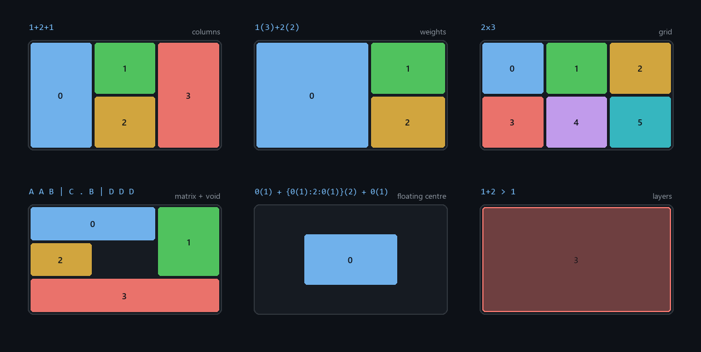

# FancyZones DSL Tiler

**Русский** · [English](README.md)

[](LICENSE)
[](https://www.python.org/)
[](https://flowlauncher.com)
[](https://github.com/RADiant-Git/FancyZones-DSL/actions/workflows/publish-release.yml)

Плагин для [Flow Launcher](https://flowlauncher.com), который собирает раскладки
[PowerToys FancyZones](https://github.com/microsoft/PowerToys) из коротких текстовых формул:

```text
fz 1(3)+2(2) -s 8 Code
```

Ввели формулу → `Enter` → раскладка скомпилирована, сохранена в PowerToys и применена к нужному
монитору. Без окна настроек и мыши.



*Каждая панель отрисована напрямую по выводу `FZCompiler`, поэтому картинка не может разойтись с
тем, что реально строит плагин.*

## Возможности

- ⌨️ **Только клавиатура** — вся раскладка умещается в одну строку текста.
- ⚖️ **Пропорции** — `1(3)+2(2)` вместо перетаскивания разделителей мышью.
- 🕳️ **Пустоты** — свободное место под виджеты или плавающее окно.
- 🥞 **Слои** — `>` складывает раскладки в один canvas с явным Z-порядком.
- 🖥️ **Мультимониторность** — `-m 2`, `-m msi` или `-m all`, отступы по реальному разрешению.
- 🔥 **Хоткеи** — `-k 3` привязывает `Win + Ctrl + Alt + 3`.

---

## Установка

Нужны Flow Launcher и PowerToys с включённым модулем FancyZones. Плагин работает через официальный
`FancyZonesCLI.exe`, который входит в состав PowerToys.

**Из магазина**

```text
pm install FancyZones DSL Tiler
```

**Вручную** — скачайте `FancyZonesDSL.zip` из
[последнего релиза](https://github.com/RADiant-Git/FancyZones-DSL/releases/latest) и распакуйте в
`%APPDATA%\FlowLauncher\Plugins\FancyZonesDSL\`.

**Из исходников**

```cmd
git clone https://github.com/RADiant-Git/FancyZones-DSL.git "%APPDATA%\FlowLauncher\Plugins\FancyZonesDSL"
```

Каталог `lib/` с зависимостью уже лежит в репозитории, поэтому `pip install` не нужен. После
установки перезапустите Flow Launcher (`Ctrl + R` в строке поиска).

Ключевое слово — `fz`. Его можно сменить в настройках плагина.

---

## Синтаксис

```text
fz <геометрия | слои> [-s <px>] [-k <0-9>] [-m <монитор>] [Имя]
```

| Флаг | Значение | По умолчанию |
| :--- | :--- | :--- |
| `-s <px>` | отступ между зонами, `0…200` | `16` |
| `-k <0-9>` | привязать хоткей `Win + Ctrl + Alt + N` | — |
| `-m <монитор>` | номер (от 1), подстрока имени/серийника или `all` | активный монитор |

Флаги работают и с именами сохранённых раскладок:

```text
fz Code -m 2         применить сохранённую «Code» на монитор №2
fz Master L -k 5     привязать Win+Ctrl+Alt+5
fz -m all            список всех раскладок для применения на все мониторы
```

Если имя не указано, раскладка пишется в переиспользуемый слот `Temp` — отдельный для каждого
монитора, так что перезапись формулы на одном экране не меняет сетку на другом. Чтобы раскладка
сохранилась навсегда, дайте ей имя.

### Блоки

Каждый элемент цепочки колонок (`+`) или строк (`/`) описывается двумя числами: сколько в нём зон и
какой у него относительный вес.

| Запись | Зон | Вес | Значение |
| :--- | :---: | :---: | :--- |
| `1` | 1 | 1 | одна зона базового размера |
| `1(2)` | 1 | 2 | одна зона вдвое больше базовой |
| `N` | N | 1 | `N` равных зон |
| `N(w)` | N | w | `N` равных зон в блоке в `w` раз больше базового |
| `0` / `0(w)` | 0 | 1 / w | пустота (свободный стол) |
| `{3:1}` | 2 | 1 | блок с делением 75 % / 25 % |
| `{1:0:1}` | 2 | 1 | зона, пустота, зона |

Внутри `{}` числа — это **веса**, а не количества: `{3:1}` даёт две зоны, а не три. Вне скобок
число — именно количество: `3` — три равные зоны.

### Режимы

- **Колонки** — `+` делит экран слева направо. `1+2+1` даёт 4 зоны.
- **Строки** — `/` делит экран сверху вниз. `1/3/1` даёт 5 зон.
- **Сетка** — `RxC` строит равномерную таблицу, например `2x2` или `3x4`. Оба размера должны быть
  больше нуля.
- **Матрица** — `|` или `;` разделяет строки ASCII-схемы. Ячейки с одной буквой образуют одну зону,
  а ячейки каждой буквы должны складываться в прямоугольник; `0`, `.` и `_` — пустота.
  Пример: `A A B | C . B | D D D`.
- **Слои** — `>` собирает раскладки и формулы в один canvas, поздние слои ложатся сверху. Чтобы
  пристыковать окно в перекрывающуюся зону, удерживайте `Shift` при перетаскивании.
  Пример: `1+2 > 1`.

Раскладка с любой пустотой компилируется в `canvas` — нативная сетка FancyZones не умеет дыры.
Для canvas отступ `-s` считается по реальному разрешению целевого монитора, поэтому 16 px остаются
16 px и на 1080p, и на 4K.

---

## Примеры

| Задача | Команда |
| :--- | :--- |
| Редактор на 60 % слева, два окна справа | `fz 1(3)+2(2) -s 8 Code` |
| Окно 50×50 % ровно по центру | `fz 0(1) + {0(1):2:0(1)}(2) + 0(1) CenterFloat` |
| Свободный центр на ультрашироком экране | `fz 1(2) + 0(3) + 1(2) -s 10 WideSplit` |
| Полоса под виджеты сверху | `fz 1 + {0(1):3}(2) + 1 DashLayout` |
| Фокусная зона поверх сетки | `fz 1+2 > 1 -k 1 DevStack` |
| Слияние двух сохранённых раскладок | `fz Master L > Solo Left Combined` |
| Сетка встык, без зазоров | `fz 2x2 -s 0` |
| Своя сетка на второй монитор | `fz 3x2 -m 2 Docs` |
| Одинаково на всех мониторах | `fz 1(3)+2(2) -s 8 -m all Code` |
| Три полосы: панель, окна, панель | `fz 1 / 3 / 1 Trio` |

---

## Поиск и управление

| Ввод | Результат |
| :--- | :--- |
| `fz` | список всех сохранённых раскладок |
| `fz cod` | нечёткий поиск по имени |
| `fz Code` | применить раскладку «Code» |
| `fz 1+2+1` | скомпилировать и применить формулу |

Точное совпадение с именем важнее компиляции, поэтому раскладка с именем `2 Monitor` применится по
`fz 2 Monitor`. Обратная сторона: `fz 1+2 Solo` создаст новую раскладку и перезапишет существующую
`Solo`.

Контекстное меню (`Shift + Enter` или правая кнопка мыши на результате):

- **Применить**, **Применить ко всем мониторам**, **Применить к монитору №N** — по одному пункту на
  каждый подключённый монитор.
- **Наложить на «X»** / **Положить под «X»** — слияние с другой раскладкой в новый canvas.
- **Сделать копию** — клон с новым GUID, без применения.
- **Сейчас применён на** — на каких мониторах раскладка используется.
- **Удалить макет** — намеренно последним пунктом.

---

## Как это работает

```text
Flow Launcher -> main.py -> fz_compiler.py -> fz_backend.py -> FancyZonesCLI.exe
```

- `main.py` — поверхность JSON-RPC: обработка запроса, построение результатов, контекстное меню и
  методы, которые Flow Launcher вызывает обратно.
- `fz_compiler.py` — чистый разбор и компиляция, без ввода-вывода. Границы зон считаются через
  `fractions.Fraction`, а не float, поэтому пропорции попадают ровно в заданные проценты.
- Сплошная раскладка становится нативным `grid`, раскладка с пустотами или слоями — `canvas`
  в опорном пространстве 10000×10000, которое FancyZones масштабирует под любое разрешение.
- `fz_backend.py` пишет макеты в `custom-layouts.json`, читает `applied-layouts.json` и вызывает
  CLI: `get-monitors`, `s <uuid> [--monitor N | --all]`, `shk <0-9> <uuid>`.

Плагин правит только `%LOCALAPPDATA%\Microsoft\PowerToys\FancyZones\custom-layouts.json`, не трогает
настройки и реестр. Сбои CLI пишутся в `plugin.log` рядом с плагином.

---

## Если что-то не работает

- **«FancyZonesCLI.exe не найден».** Раскладка сохранится, но не применится. Проверьте, что PowerToys
  установлена и модуль FancyZones включён: `where FancyZonesCLI.exe`.
- **Раскладка сохраняется, но на экране ничего не меняется.** Уже открытые окна не переезжают сами —
  FancyZones пристыковывает только те, которые вы перетаскиваете. Проверьте `plugin.log`.
- **Номер монитора.** `-m 1` — это первый монитор по нумерации PowerToys, а не обязательно тот,
  который вы ожидаете. Посмотреть: `"C:\Program Files\PowerToys\FancyZonesCLI.exe" get-monitors`.
  Обычно проще указать `-m all` или подстроку имени: `-m msi`.
- **«Зона 'A' не образует прямоугольник».** В матрице ячейки каждой буквы должны складываться
  в прямоугольник: `A A | A A` — корректно, `A A | A B` — нет.

---

## Разработка

```cmd
git clone https://github.com/RADiant-Git/FancyZones-DSL.git
cd FancyZones-DSL
python -m unittest discover -v
```

70 юнит-тестов покрывают компилятор, бэкенд и поверхность плагина; установка PowerToys не требуется,
тесты работают на мок-бэкенде. Зависимостей, кроме встроенной в `lib/` библиотеки `flowlauncher`,
у проекта нет.

Плагин можно запустить напрямую, он говорит на том же JSON-RPC, что и Flow Launcher:

```cmd
python main.py "{\"method\":\"query\",\"parameters\":[\"2x2 -m 1 Test\"]}"
```

**Картинка раскладок.** `Images/preview.png` не нарисована вручную, а сгенерирована:

```cmd
pip install Pillow
python tools/make_previews.py
```

Показанные формулы лежат в списке `FORMULAS` в начале скрипта, а каждый прямоугольник берётся из
`FZCompiler` — перезапускайте его после изменений в компиляторе.

**Релизы.** Версия берётся из `plugin.json`. Пуш в `main` запускает
[`publish-release.yml`](.github/workflows/publish-release.yml): он прогоняет тесты, собирает
`FancyZonesDSL.zip` и публикует GitHub Release с тегом `v<версия>`. Магазин Flow Launcher сам
подхватывает новый релиз и обновляет свою запись.

**Отправка в магазин** (один раз): форкнуть
[Flow-Launcher/Flow.Launcher.PluginsManifest](https://github.com/Flow-Launcher/Flow.Launcher.PluginsManifest),
скопировать [`store/…json`](store/) в каталог `plugins/` и открыть pull request. Имя файла должно
остаться `<Name>-<ID>.json` и совпадать с `plugin.json`.

---

## Лицензия

[MIT](LICENSE) © RADiant-Git

---

## Changelog

**1.5.0** — 2026-11-07
Персональные слоты `Temp` на каждый монитор, автоматическая миграция мониторов, ссылающихся на
перезаписываемый слот. В контекстном меню: применение по мониторам, «наложить на» / «положить под»,
копирование, «сейчас применён на».

**1.4.0** — 2026-11-07
Первая версия буфера `Temp` по мониторам: безымянные раскладки пишутся в слот целевого экрана.

**1.3.1** — 2026-11-06
Флаги `-s` / `-k` / `-m` работают и с именами сохранённых раскладок.

**1.3.0** — 2026-11-06
Мультимониторная адресация (`-m номер | имя | all`), отступы canvas по реальному разрешению
монитора, строгая проверка флагов.

**1.2.0** — 2026-11-06
Ужесточена обработка флагов и сообщения об ошибках.

**1.1.0**
Плавающие раскладки на пустотах и многослойная композиция оператором `>`.

**1.0.0**
Первый выпуск: колонки, строки, быстрые сетки и буквенные матрицы.
